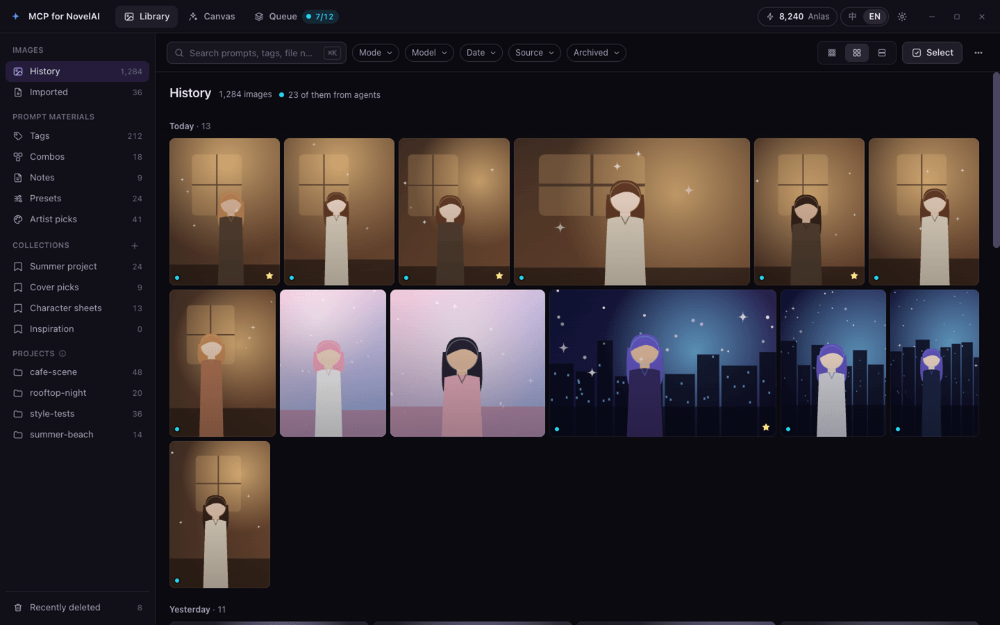
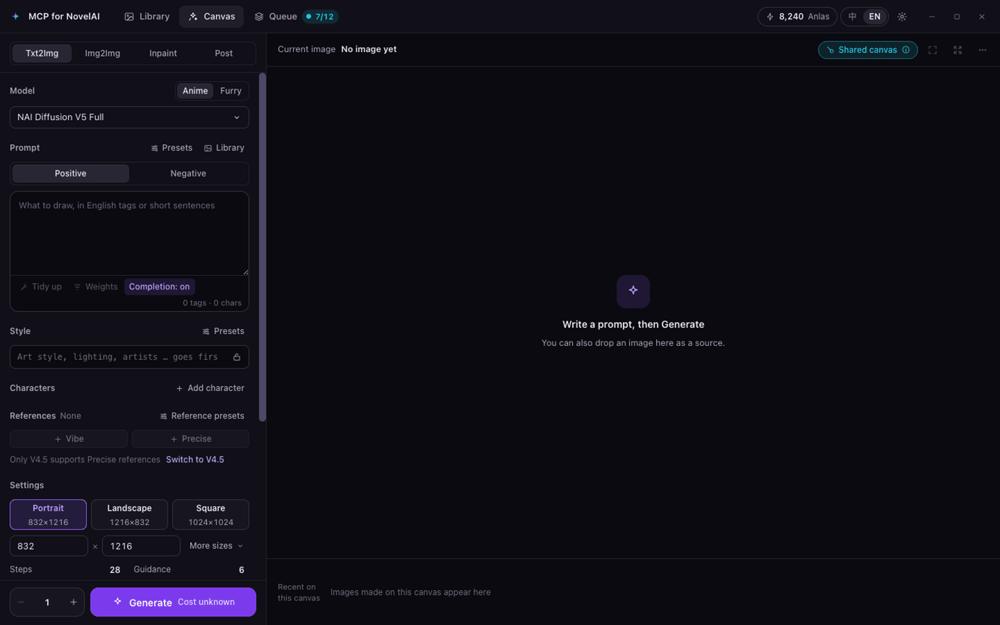
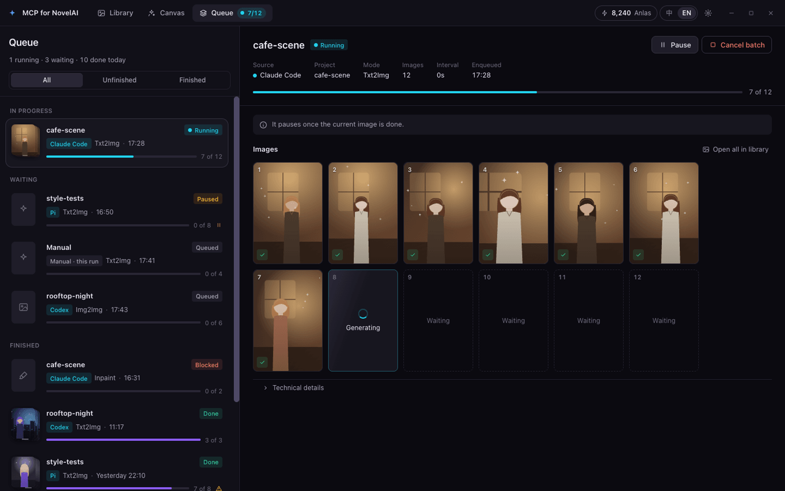
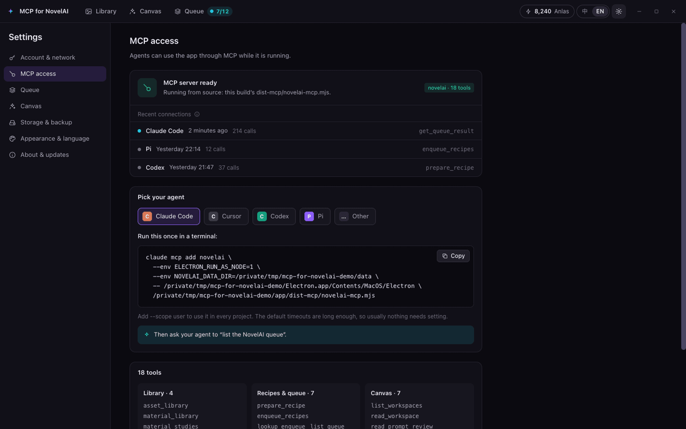

# MCP for NovelAI

A desktop NovelAI image client that your AI agent can drive: Claude Code, Cursor, Codex, Pi or any other MCP client
prepares recipes, queues images and organises your library through MCP, while you watch, steer and paint in the app.

**English** · [简体中文](README.zh-CN.md)



> [!WARNING]
> **Agents generate with your NovelAI account.** When an agent calls `enqueue_recipes`, the app sends those images to
> NovelAI with your token right away — **there is no per-image confirmation**, and images outside your subscription's
> free allowance spend Anlas. Each enqueue carries a `requestKey`, so a retried call never pays twice for the same
> intent. The queue page shows every batch, and you can pause or cancel any of them there; Settings › Queue limits how
> many images one enqueue and the whole queue may hold.

## Features

- **Library** (the home page): history images by day, imported images, and prompt materials — tags, combos, notes,
  presets, artist picks — with search, filters (mode, model, date, source, archived), collections, projects, a detail
  drawer, version history and multi-select. Deleted items go to **Recently deleted** for 30 days.
- **Canvas**: a manual workbench for Txt2Img, Img2Img, Inpaint (with mask painting) and Post (Enhance, Upscale,
  Director tools). An agent's proposed edits appear as visible drafts that you apply or discard.
- **Shared queue**: every image, from an agent or from the canvas, goes through one queue in order. Pause, resume and
  cancel per batch; when an image fails or its outcome is unknown, later agent batches pause until you check.
- **Agent connection**: Settings › MCP access writes the exact configuration for Claude Code, Cursor, Codex, Pi or any
  `mcpServers` client, with this computer's paths, and shows which agents connected recently.
- **Backups**: automatic backups and portable `.naisbackup` exports; your API token is never in an automatic backup.
- English and Chinese interface, dark theme.

| Canvas | Queue | Settings › MCP access |
| --- | --- | --- |
|  |  |  |

### 18 MCP tools

| Group | Tools |
| --- | --- |
| Library | `asset_library`, `material_library`, `material_studies`, `tag_details` |
| Recipes & queue | `prepare_recipe`, `enqueue_recipes`, `lookup_enqueue`, `list_queue`, `read_queue`, `get_queue_result`, `control_queue` |
| Canvas | `list_workspaces`, `read_workspace`, `read_prompt_review`, `get_asset`, `draft_edit`, `apply_edit`, `undo_edit` |

Only `enqueue_recipes` starts generation (and `control_queue` resuming a paused batch continues one). The canvas tools
read the canvas and stage visible drafts; they never generate. Details: [MCP tools reference](docs/mcp-tools.md).

## Before you start

- A **NovelAI subscription** and a **Persistent API Token**. In the NovelAI web app: menu (three lines, top left) ›
  Account Settings › Get Persistent API Token › Overwrite, then copy the whole token (it starts with `pst-`; it is shown
  only once and replaces the old one). Paste it in the app's first-run guide or in Settings › Account & network and click
  **Verify & save**.
- An MCP client (Claude Code, Cursor, Codex, Pi, …) on the same computer.

## Install

Download the file for your system from the [latest release](https://github.com/lwyq1209/mcp-for-novelai/releases/latest):

| System | File |
| --- | --- |
| macOS, Apple silicon (M1 and later) | `MCP-for-NovelAI-<version>-mac-arm64.dmg` |
| macOS, Intel | `MCP-for-NovelAI-<version>-mac-x64.dmg` |
| Windows 10/11, x64 | `MCP-for-NovelAI-<version>-win-x64-setup.exe` |
| Linux, x64 | `MCP-for-NovelAI-<version>-linux-x64.tar.gz` |

Each release also has `SHA256SUMS.txt`, the SHA-256 checksum of every file: compare the line of your download with the
output of `shasum -a 256 <file>` (macOS), `sha256sum <file>` (Linux) or `Get-FileHash <file>` (Windows PowerShell).
`SHA256SUMS.txt.sig` is its signature, which the in-app update checks ([docs/updates.md](docs/updates.md#checking-a-release-yourself)
shows how to check it yourself). The source code of the bundled image libraries is there too (see
[Credits and license](#credits-and-license)).

**macOS** — not sure which Mac you have? Apple menu › **About This Mac**: "Chip: Apple M…" is Apple silicon,
"Processor: Intel…" is Intel. (The same app also comes as a `.zip`.) Open the disk image and drag the app to
**Applications**. The app is signed with the project's own (self-signed) certificate but not notarized by Apple, so macOS
refuses it the first time: open it once, then go
to **System Settings › Privacy & Security**, scroll to **Security** and click **Open Anyway** (offered for about an hour
after the attempt), and confirm with your password. Control-click › Open no longer skips this check on current macOS
(since macOS 15). Run the app from Applications: run from the disk image or a downloads folder, its path changes on
every launch and agent configurations break.

**Open Anyway** only covers starting the app with a double-click: an agent runs the MCP server inside the app
directly, and macOS still blocks that with "Apple could not verify …". Run this once in Terminal after installing
(and again after installing a new version):

```sh
xattr -dr com.apple.quarantine "/Applications/MCP for NovelAI.app"
```

It removes the quarantine mark macOS puts on downloaded files, which is the same as telling macOS that you trust this
app.

**Windows** — run the `setup` installer. The installer is not code-signed yet, so SmartScreen may show "Windows
protected your PC": click **More info**, then **Run anyway**.

**Linux** — extract the `.tar.gz` and put the extracted folder where it stays, under a name without the version (for
example `~/Applications/mcp-for-novelai`), then run `mcp-for-novelai` in it. Agent configurations point at that folder:
to update, replace its contents with the new version's, keeping the folder's name and place (or copy the configuration
again). If the app does not start and reports that the SUID sandbox helper is not configured correctly, see
[Troubleshooting](docs/troubleshooting.md#linux-the-app-does-not-start).

### Build from source

Needs [Node.js](https://nodejs.org/) 22.12 or later and Git. From a clone of this repository:

```sh
npm ci --prefix novelai
npm ci --prefix novelai/client
node novelai/client/node_modules/electron/install.js
node novelai/scripts/start-client.mjs
```

`start-client.mjs` builds the app and starts it (`--no-build` skips the build next time, `--data-dir <folder>` uses a
separate data folder; on Windows you can double-click `novelai\scripts\start-client.cmd`). See
[Building and development](docs/building.md).

## Connect an agent

Open **Settings › MCP access** (or step 2 of the first-run guide), pick your agent and copy what it shows: the app fills
in its own executable, the bundled MCP server file and its data folder. The server runs with the app's own executable
as Node (`ELECTRON_RUN_AS_NODE=1`), so you do not need Node.js. Then ask your agent to "list the NovelAI queue".
On **macOS**, run the `xattr` command from [Install](#install) once first: without it macOS blocks the agent's MCP
server with "Apple could not verify …", even after **Open Anyway**.

**The agent opens the app itself.** When the app is not running, the first call that needs it makes the MCP server
start the app in the background, and the call goes on once the app is ready (at most about 30 seconds). The app does
not show its window or take the focus: on **macOS** only its Dock icon appears — click it to show the window; on
**Windows** it appears minimized in the taskbar — click its button; on **Linux** it runs in the background without a
taskbar entry — open the app again (for example from the application menu) to see its window. Only a call that
certainly reached no app does this; a call whose outcome may be unknown is never sent again. To turn it off,
add `NOVELAI_MCP_AUTOSTART=0` to the `env` of the agent's configuration: the agent then gets `unavailable` and asks you
to open the app (it still waits for an app that is already starting). A server you run from source with your own Node
never starts the app. On macOS the app starts through LaunchServices in the background; on Windows outside the agent's
process tree (WMI), so closing the agent's terminal does not close it; on Linux as a detached process.

The shapes below show what the page generates; `<app>`, `<server>` and `<data folder>` stand for the paths the page
fills in.

**Claude Code** — run once in a terminal (add `--scope user` to use it in every project):

```sh
claude mcp add novelai --env ELECTRON_RUN_AS_NODE=1 --env NOVELAI_DATA_DIR=<data folder> -- <app> <server>
```

**Cursor** — add to `~/.cursor/mcp.json` (or `.cursor/mcp.json` in a project). Cursor has no tool timeout setting; if it
reports a timeout on a large enqueue, check the queue page before letting the agent resend.

```json
{
  "mcpServers": {
    "novelai": {
      "type": "stdio",
      "command": "<app>",
      "args": ["<server>"],
      "env": { "ELECTRON_RUN_AS_NODE": "1", "NOVELAI_DATA_DIR": "<data folder>" }
    }
  }
}
```

**Codex** — add to `~/.codex/config.toml` (or `.codex/config.toml` in a trusted project):

```toml
[mcp_servers.novelai]
command = "<app>"
args = ["<server>"]
startup_timeout_sec = 30
tool_timeout_sec = 1560

[mcp_servers.novelai.env]
ELECTRON_RUN_AS_NODE = "1"
NOVELAI_DATA_DIR = "<data folder>"
```

**Pi** (built-in MCP, Pi 0.99 and later) — add to `~/.pi/agent/mcp.json` (or `.pi/mcp.json` in a project):

```json
{
  "mcpServers": {
    "novelai": {
      "command": "<app>",
      "args": ["<server>"],
      "env": { "ELECTRON_RUN_AS_NODE": "1", "NOVELAI_DATA_DIR": "<data folder>" },
      "timeout": 1560
    }
  }
}
```

**DeepSeek Harness** (dsh) — following its documentation (DSH MCP Integration and Configuration;
[`@deepseek-ai/dsh-mcp-client`](https://github.com/deepseek-ai/deepseek-harness/blob/master/packages/mcp/mcp-client/README.md)):
add this row to `~/.dsh/cordis.patch.yml` (every profile; for one profile `~/.dsh/profiles/<profile>/cordis.patch.yml`
— not `cordis.yml`, which dsh rewrites empty on every start), then restart dsh. If the file already has an `- insert:`
list, add only the `novelai` row to it. `toolCallTimeoutMs` is set because dsh's default of 60 seconds is too short
for a large enqueue.

```yaml
- insert:
    - id: mcp-novelai
      name: '@deepseek-ai/dsh-mcp-client'
      config:
        serverName: novelai
        transport: stdio
        command: "<app>"
        args: ["<server>"]
        env:
          ELECTRON_RUN_AS_NODE: "1"
          NOVELAI_DATA_DIR: "<data folder>"
        toolCallTimeoutMs: 1560000
```

**Other clients** configured with `mcpServers` (for example Claude Desktop's `claude_desktop_config.json`): merge the
same entry without `type` and `timeout`, and set the client's tool timeout to 26 minutes (1560 seconds) or more — a
large enqueue can take minutes.

If a file already has `mcpServers` (or other `[mcp_servers.…]` tables), add only the `novelai` entry. Settings › MCP
access › Advanced also shows how to run the server from a source checkout with your own Node, and where the agent's
inbox folders are.

## Data and privacy

| What | Where |
| --- | --- |
| Data folder (library, queue, settings, backups, logs) | macOS `~/Library/Application Support/mcp-for-novelai` · Windows `%APPDATA%\mcp-for-novelai` · Linux `$XDG_CONFIG_HOME/mcp-for-novelai` (default `~/.config/mcp-for-novelai`). The environment variable `NOVELAI_DATA_DIR` chooses another folder. |
| Generated images | `<Pictures>/MCP for NovelAI` by default (Settings › Storage & backup › Output folder); an agent's project saves into `<date>/<project>/` there. With `NOVELAI_DATA_DIR` set, `output/` in that folder. |
| Automatic backups | `backups/` in the data folder by default; every 24 hours, the last 7 kept, without images unless you include them, never with your API token (Settings › Storage & backup). |
| Recently deleted | Kept 30 days, then purged automatically. |
| Ended queue batches | Their records are cleaned after 30 days by default (Settings › Queue: 7, 30 or 90 days, or Forever); the images stay in the library. |

- **Your API token** is encrypted with Electron's `safeStorage` before it is written to the settings file: the
  Keychain on macOS, DPAPI on Windows, the desktop's secret store (GNOME Keyring, KWallet) on Linux. When encryption
  is not available the app refuses to save it. On Linux without a secret store, Electron falls back to a built-in key
  that does not protect the token. Manual backup exports leave the token out unless you select API credentials and
  confirm.
- **The app connects to:**
  - NovelAI — `api.novelai.net` (token check, account and balance) and `image.novelai.net` (generation, upscale,
    Director and the other image requests). Your token is sent only to `*.novelai.net` addresses; others are refused
    unless you allow them under Custom API address in Settings › Account & network.
  - Danbooru — `danbooru.donmai.us` when you or an agent look up, search or save Danbooru tags (also the MCP server's
    `tag_details`), and `cdn.donmai.us` for a tag's sample images, only when you open them (or use one as a cover).
  - GitHub — `api.github.com` to check for a new release; with **Update and restart**, `github.com` and GitHub's
    download hosts (`release-assets.githubusercontent.com`, `objects.githubusercontent.com`) for that release's files
    (see [Updates](#updates)). **Download** opens the release page in your browser.
  - `raw.githubusercontent.com` only when you run the optional Chinese tag dictionary installer
    (`novelai/scripts/install-tag-dictionary.mjs`).
  - Your proxy, if you set one (Settings › Account & network › Proxy; it follows the system proxy by default).
- The MCP server talks to the app only on `127.0.0.1`, with a secret the app writes into its data folder. When the app
  is not running, the server may start it (see [Connect an agent](#connect-an-agent); `NOVELAI_MCP_AUTOSTART=0` turns
  that off).
- **No telemetry, analytics or crash reporting.** The app records which agent called which tool and when (never the
  arguments) on this computer only, to show it in Settings › MCP access and on the queue page.

## Updates

An installed app checks the [latest GitHub release](https://github.com/lwyq1209/mcp-for-novelai/releases/latest) a few
seconds after it starts and then every 6 hours, and shows a newer version in the top bar and in **Settings › About &
updates**. Turn the checks off there (**Check for updates automatically**); **Check for updates** works any time. A
build from source does not check on its own.

- **Update and restart** downloads the new version, checks it against the release's signed checksum list
  (`SHA256SUMS.txt.sig`, Ed25519, with the key built into the app; on macOS also its code signature and certificate),
  replaces the installed app in the same place and opens it again. Nothing that fails a check is installed ("The update
  could not be verified"). The download shows its progress, can be cancelled and continues where it stopped. The app
  waits while the queue has batches generating or waiting (**Update after the queue**; pause them on the queue page to
  update now) and quits the normal way; in the few seconds it hands over to its update helper it starts no image, and a
  batch that arrives then calls the update off. Your library, queue, settings and images stay as they are, and agent
  configurations stay valid. On macOS and Linux, if the new version does not start, the old one is put back.
  **Windows has no rollback of its own**: it relies on the NSIS installer (which leaves the old version when it stops
  before replacing files; otherwise run the setup by hand), and the installer ends agents' running MCP servers: a call
  under way fails, and the agent must start the server again (many do so with their next call, some need it
  reconnected, for example `/mcp` in Claude Code). During the update MCP servers do not start the app (`unavailable`,
  `details.autostart: "updating"`; call again in a minute). The first start afterwards says **Updated to x.y.z**, with
  a link to what changed.
- **Download** opens the release page, as before. It is the only choice where the app cannot replace itself: macOS run
  from Downloads or the disk image, a folder you cannot write to, Windows installed for all users, a Linux folder whose
  `chrome-sandbox` root set up.
- **Updating to 0.1.3 is done by hand** (earlier versions cannot update themselves yet). On macOS the Keychain then
  asks once more for the app's Safe Storage key: from 0.1.3 the app is signed with a fixed certificate, so **Always
  Allow** stays valid across later updates.

How it works, how to verify a release yourself, App Management on macOS and the threat model:
[docs/updates.md](docs/updates.md).

## Documentation

- [MCP tools reference](docs/mcp-tools.md) — every tool, request keys, the queue, retention, projects
- [Updates](docs/updates.md) — the in-app update, verifying a release, the threat model
- [Troubleshooting](docs/troubleshooting.md) — error codes and what to do
- [Building and development](docs/building.md) — from source, tests, dev tools
- [Changelog](CHANGELOG.md) · [Contributing](CONTRIBUTING.md) · [Security](SECURITY.md)

## Not affiliated with NovelAI

NovelAI is a trademark of Anlatan. This is an independent project; it is not affiliated with, endorsed by or supported
by Anlatan or NovelAI. You need your own NovelAI account.

## Credits and license

Based on **Langbai NovelAI Studio** 2.2.8 (MIT License) — <https://github.com/2786886095/novelai-image-desktop>,
Copyright (c) 2026 Langbai. Thanks to its author for releasing it under the MIT License.

MCP for NovelAI is released under the [MIT License](LICENSE) (Copyright (c) 2026 Langbai, Copyright (c) 2026 lwyq1209).
The app also contains third-party software under its own licenses, listed in
[THIRD_PARTY_NOTICES.md](novelai/client/THIRD_PARTY_NOTICES.md) and shown in Settings › About & updates. Some of the
image libraries inside it (libvips and others) are under the GNU LGPL: their source code is attached to every release as
`third-party-sources-<version>.tar.gz`. The source of Electron, which the app uses unmodified, is that of the Electron
version named in the notices.
