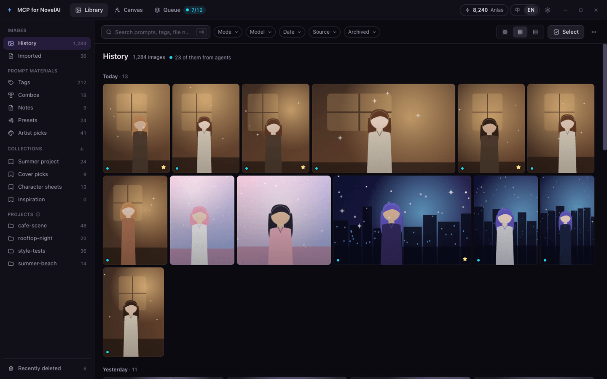
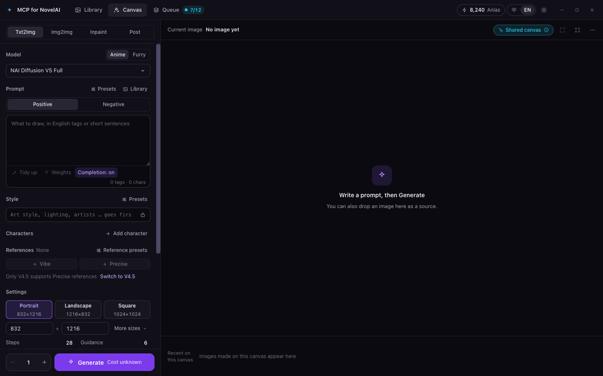
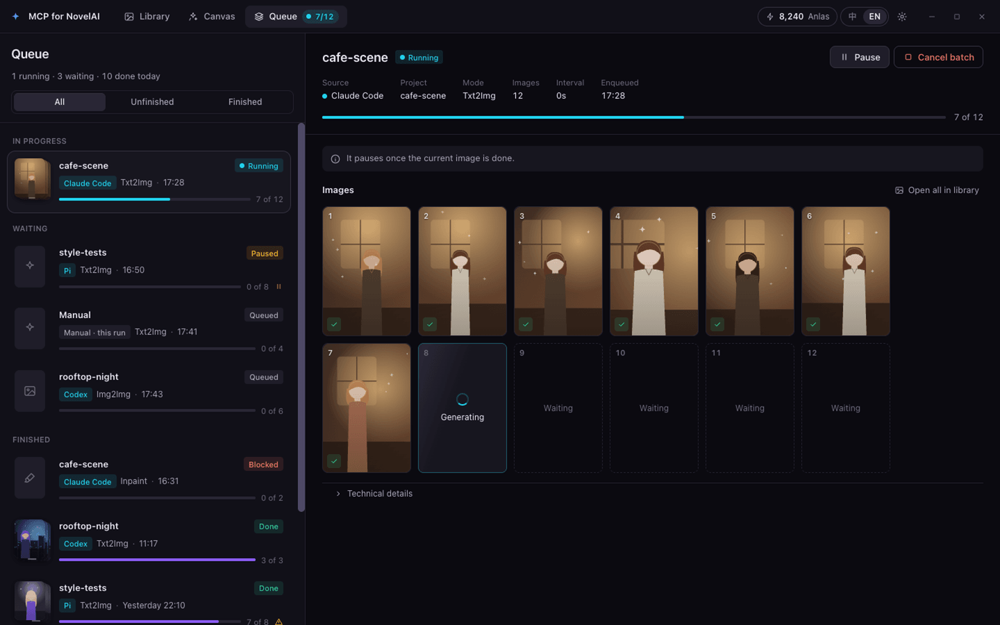
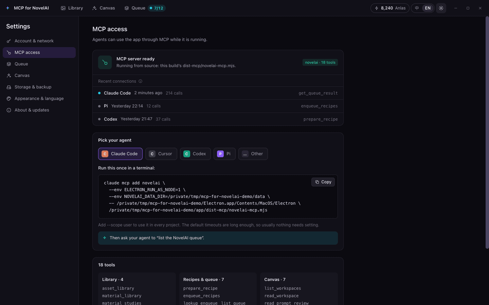

# MCP for NovelAI

一个让 AI Agent 来操作的 NovelAI 桌面出图客户端：Claude Code、Cursor、Codex、Pi 或任何 MCP 客户端通过 MCP
准备配方、排队出图、整理素材库，你在应用里看着、调整、画蒙版。

[English](README.md) · **简体中文**



> [!WARNING]
> **Agent 用你的 NovelAI 账号出图。** Agent 调用 `enqueue_recipes` 后，应用会立即用你的 token 把这些图发给
> NovelAI——**没有逐张确认**，订阅免费额度以外的出图会消耗 Anlas。每次入队都带一个 `requestKey`，同一个意图重试时
> 不会重复付费。队列页列出所有批次，可以随时暂停或取消；「设置 › 队列」可以限制单次入队和整个队列的张数。

## 主要功能

- **素材库**（首页）：按天分组的历史图片、导入的图片，以及提示词素材——标签、组合、心得、预设、画师收藏；支持
  搜索、筛选（模式、模型、日期、来源、归档）、收藏夹、项目、详情抽屉、版本历史和多选。删除的条目进入**最近删除**，
  保留 30 天。
- **画布**：手动工作台，支持文生图、图生图、局部重绘（可画蒙版）和后期（增强、放大、Director 工具）。Agent 提出的
  修改以可见草稿出现，由你应用或放弃。
- **共享队列**：Agent 和画布的每张图都按顺序走同一个队列。可以按批次暂停、继续、取消；一张图失败或结果未知时，
  后面的 Agent 批次会自动暂停，等你核对。
- **Agent 接入**：「设置 › MCP 接入」按本机路径生成 Claude Code、Cursor、Codex、Pi 或任何 `mcpServers` 客户端的
  配置，并显示最近连接过的 Agent。
- **备份**：自动备份，以及可在别的电脑上恢复的 `.naisbackup` 导出；自动备份从不包含 API token。
- 中文、英文界面，深色主题。

| 画布 | 队列 | 设置 › MCP 接入 |
| --- | --- | --- |
|  |  |  |

（截图为英文界面，使用合成示例数据。）

### 18 个 MCP 工具

| 分组 | 工具 |
| --- | --- |
| 素材库 | `asset_library`、`material_library`、`material_studies`、`tag_details` |
| 配方与队列 | `prepare_recipe`、`enqueue_recipes`、`lookup_enqueue`、`list_queue`、`read_queue`、`get_queue_result`、`control_queue` |
| 画布 | `list_workspaces`、`read_workspace`、`read_prompt_review`、`get_asset`、`draft_edit`、`apply_edit`、`undo_edit` |

只有 `enqueue_recipes` 会开始出图（`control_queue` 继续一个已暂停的批次时，也会接着出图）。画布工具只读取画布、
提交可见草稿，从不出图。详见 [MCP 工具参考](docs/mcp-tools.md)（英文）。

## 开始之前

- 需要 **NovelAI 订阅**和 **Persistent API Token**。在 NovelAI 网页版：左上角三横线菜单 › Account Settings ›
  Get Persistent API Token › Overwrite，然后立即复制以 `pst-` 开头的完整 token（只显示这一次，生成新 token 会让旧的
  失效）。在应用的首次引导或「设置 › 账号与网络」里粘贴，点「验证并保存」。
- 同一台电脑上的 MCP 客户端（Claude Code、Cursor、Codex、Pi……）。

## 安装

从[最新发布](https://github.com/lwyq1209/mcp-for-novelai/releases/latest)下载对应系统的文件：

| 系统 | 文件 |
| --- | --- |
| macOS，Apple 芯片（M1 及以后） | `MCP-for-NovelAI-<version>-mac-arm64.dmg` |
| macOS，Intel | `MCP-for-NovelAI-<version>-mac-x64.dmg` |
| Windows 10/11，x64 | `MCP-for-NovelAI-<version>-win-x64-setup.exe` |
| Linux，x64 | `MCP-for-NovelAI-<version>-linux-x64.tar.gz` |

每个发布还附有 `SHA256SUMS.txt`，列出每个文件的 SHA-256 校验值：用 `shasum -a 256 <文件>`（macOS）、`sha256sum <文件>`
（Linux）或 `Get-FileHash <文件>`（Windows PowerShell）算出下载文件的值，和其中对应的一行比对。`SHA256SUMS.txt.sig`
是它的签名，应用内更新会验证它（自己验证的方法见 [docs/updates.md](docs/updates.md#checking-a-release-yourself)，英文）。
随包图像库的源码也在发布里（见[致谢与许可](#致谢与许可)）。

**macOS**：不确定自己的 Mac 是哪种？苹果菜单 ›「**关于本机**」：写着「芯片 Apple M…」的是 Apple 芯片，写着「处理器
Intel…」的是 Intel。（同一个应用也有 `.zip` 版。）打开磁盘映像，把应用拖进「应用程序」。应用用本项目自己的（自签名）证书签名，但没有经过
苹果公证，所以第一次会被系统拦下：先打开一次，再到「**系统设置 › 隐私与安全性**」，向下找到「安全性」，点「**仍要打开**」
（尝试打开后约一小时内有这个按钮），输入登录密码确认。当前的 macOS（macOS 15 起）已经不能再用「按住 Control 点按 ›
打开」绕过这一步。请从「应用程序」运行：直接在磁盘映像或下载文件夹里运行时，路径每次启动都会变，Agent 的配置会失效。

「仍要打开」只对双击启动应用生效：Agent 直接运行应用里的 MCP 服务时，macOS 仍会以「Apple 无法验证……」拦下。安装后
（以及每次装了新版本后）在「终端」里运行一次：

```sh
xattr -dr com.apple.quarantine "/Applications/MCP for NovelAI.app"
```

它去掉 macOS 给下载文件加的隔离标记，相当于告诉系统你信任这个应用。

**Windows**：运行 `setup` 安装程序。安装程序暂未签名，SmartScreen 可能提示「Windows 已保护你的电脑」：点「**更多信息**」，
再点「**仍要运行**」。

**Linux**：解压 `.tar.gz`，把解出的文件夹放到固定位置、用不带版本号的名字（例如 `~/Applications/mcp-for-novelai`），
然后运行其中的 `mcp-for-novelai`。Agent 的配置指向这个文件夹：升级时用新版本的内容替换它，文件夹的名字和位置保持
不变（或者重新复制一次配置）。如果应用启动不了、提示 SUID sandbox helper 配置不正确，见[故障排查](docs/troubleshooting.md#linux-the-app-does-not-start)（英文）。

### 从源码构建

需要 [Node.js](https://nodejs.org/) 22.12 或更高版本和 Git。在本仓库的克隆里运行：

```sh
npm ci --prefix novelai
npm ci --prefix novelai/client
node novelai/client/node_modules/electron/install.js
node novelai/scripts/start-client.mjs
```

`start-client.mjs` 会先构建再启动（下次加 `--no-build` 跳过构建，`--data-dir <文件夹>` 使用单独的数据文件夹；
Windows 上也可以双击 `novelai\scripts\start-client.cmd`）。详见[构建与开发](docs/building.md)（英文）。

## 接入 Agent

打开「**设置 › MCP 接入**」（或首次引导的第 2 步），选择你的 Agent，复制页面给出的内容：应用会填好它自己的可执行文件、
随包附带的 MCP 服务文件和数据文件夹。MCP 服务用应用自带的可执行文件以 Node 方式运行（`ELECTRON_RUN_AS_NODE=1`），
不需要另装 Node.js。接好后，在 Agent 里说一句「列出 NovelAI 队列」试试。**macOS** 上请先运行一次[安装](#安装)里的
`xattr` 命令：不运行的话，即使点过「仍要打开」，macOS 也会以「Apple 无法验证……」拦下 Agent 的 MCP 服务。

**Agent 会自己打开应用。** 应用没开时，第一次需要它的调用会让 MCP 服务在后台启动应用，等应用就绪（最多约 30 秒）后继续这次
调用。应用不显示窗口、不抢前台：**macOS** 上只出现 Dock 图标，点它才显示窗口；**Windows** 上最小化在任务栏，点任务栏按钮才
显示；**Linux** 上在后台运行、没有任务栏条目，再打开一次应用（例如从应用菜单）即可看到窗口。只有「肯定没送到任何应用」的调用才会
这样；结果可能未知的调用绝不重发。不想这样：在 Agent 配置的 `env` 里加 `NOVELAI_MCP_AUTOSTART=0`，Agent 就会得到
`unavailable` 并请你自己打开应用（已经在启动中的应用仍会等它就绪）。用你自己的 Node 从源码运行的服务不会自动打开应用。
macOS 上经由 LaunchServices 在后台启动；Windows 上在 Agent 的进程树之外启动（WMI），关掉 Agent 的终端不会带走应用；
Linux 上作为脱离的进程启动。

下面是页面生成内容的格式；`<app>`、`<server>`、`<data folder>` 代表页面填入的路径。

**Claude Code**：在终端运行一次（加 `--scope user` 可以在所有项目里使用）：

```sh
claude mcp add novelai --env ELECTRON_RUN_AS_NODE=1 --env NOVELAI_DATA_DIR=<data folder> -- <app> <server>
```

**Cursor**：添加到 `~/.cursor/mcp.json`（或项目里的 `.cursor/mcp.json`）。Cursor 没有工具超时设置；入队一大批图时
如果它报超时，先到队列页核对结果，别让 Agent 重发。

```json
{
  "mcpServers": {
    "novelai": {
      "type": "stdio",
      "command": "<app>",
      "args": ["<server>"],
      "env": { "ELECTRON_RUN_AS_NODE": "1", "NOVELAI_DATA_DIR": "<data folder>" }
    }
  }
}
```

**Codex**：添加到 `~/.codex/config.toml`（或可信项目里的 `.codex/config.toml`）：

```toml
[mcp_servers.novelai]
command = "<app>"
args = ["<server>"]
startup_timeout_sec = 30
tool_timeout_sec = 1560

[mcp_servers.novelai.env]
ELECTRON_RUN_AS_NODE = "1"
NOVELAI_DATA_DIR = "<data folder>"
```

**Pi**（Pi 0.99 起内置的 MCP）：添加到 `~/.pi/agent/mcp.json`（或项目里的 `.pi/mcp.json`）：

```json
{
  "mcpServers": {
    "novelai": {
      "command": "<app>",
      "args": ["<server>"],
      "env": { "ELECTRON_RUN_AS_NODE": "1", "NOVELAI_DATA_DIR": "<data folder>" },
      "timeout": 1560
    }
  }
}
```

**DeepSeek Harness**（dsh）：按官方文档（DSH 的 MCP Integration 与 Configuration 两页；
[`@deepseek-ai/dsh-mcp-client`](https://github.com/deepseek-ai/deepseek-harness/blob/master/packages/mcp/mcp-client/README.md)），
把下面这一条加到 `~/.dsh/cordis.patch.yml`（所有 profile 都用；只给一个 profile 用就放
`~/.dsh/profiles/<profile>/cordis.patch.yml`——不是 `cordis.yml`，dsh 每次启动都会把它重写为空），然后重启 dsh。
文件里已有 `- insert:` 列表时，只把 `novelai` 这一条加进去。片段设了 `toolCallTimeoutMs`，因为 dsh 默认的 60 秒
不够入队一大批图用。

```yaml
- insert:
    - id: mcp-novelai
      name: '@deepseek-ai/dsh-mcp-client'
      config:
        serverName: novelai
        transport: stdio
        command: "<app>"
        args: ["<server>"]
        env:
          ELECTRON_RUN_AS_NODE: "1"
          NOVELAI_DATA_DIR: "<data folder>"
        toolCallTimeoutMs: 1560000
```

**其它**按 `mcpServers` 格式配置的客户端（例如 Claude Desktop 的 `claude_desktop_config.json`）：合并同样的一项
（不带 `type` 和 `timeout`），并把客户端的工具调用超时设到 26 分钟（1560 秒）以上——入队一大批图可能要几分钟。

文件里已有 `mcpServers`（或其它 `[mcp_servers.…]`）时，只加 `novelai` 这一项。「设置 › MCP 接入 › 高级」还给出了
用你自己的 Node 从源码运行 MCP 服务的命令，以及 Agent 收件箱文件夹的位置。

## 数据与隐私

| 内容 | 位置 |
| --- | --- |
| 数据文件夹（素材库、队列、设置、备份、日志） | macOS `~/Library/Application Support/mcp-for-novelai` · Windows `%APPDATA%\mcp-for-novelai` · Linux `$XDG_CONFIG_HOME/mcp-for-novelai`（默认 `~/.config/mcp-for-novelai`）。环境变量 `NOVELAI_DATA_DIR` 可以指定别的文件夹。 |
| 生成的图片 | 默认 `<图片>/MCP for NovelAI`（「设置 › 存储与备份 › 出图文件夹」）；Agent 的项目存进其中的 `<日期>/<项目>/`。设置了 `NOVELAI_DATA_DIR` 时，默认是那个文件夹里的 `output/`。 |
| 自动备份 | 默认在数据文件夹的 `backups/`；每 24 小时一次，保留最近 7 份，默认不含图片，从不包含 API token（「设置 › 存储与备份」）。 |
| 最近删除 | 保留 30 天，到期自动清除。 |
| 已结束的队列批次 | 默认 30 天后清理批次记录（「设置 › 队列」可选 7、30、90 天或永不清理）；图片仍在素材库。 |

- **API token** 写进设置文件前，先用 Electron 的 `safeStorage` 加密：macOS 用钥匙串，Windows 用 DPAPI，Linux 用
  桌面环境的密钥服务（GNOME Keyring、KWallet）。加密不可用时，应用拒绝保存。Linux 上没有密钥服务时，Electron 会退回
  一个内置密钥，起不到保护作用。手动导出备份时，只有你勾选「API 凭据」并确认，token 才会写进文件。
- **应用会连接：**
  - NovelAI：`api.novelai.net`（验证 token、账号和余额）和 `image.novelai.net`（出图、放大、Director 等图片请求）。
    token 只发给 `*.novelai.net` 的地址；别的地址会被拒绝，除非你在「设置 › 账号与网络 › 自定义 API 地址」里允许。
  - Danbooru：你或 Agent 查询、搜索、保存 Danbooru 标签时访问 `danbooru.donmai.us`（包括 MCP 服务的 `tag_details`）；
    标签的示例图只在你点开（或拿来做封面）时从 `cdn.donmai.us` 读取。
  - GitHub：`api.github.com`，检查有没有新版本；点「更新并重启」时，从 `github.com` 和 GitHub 的下载服务器
    （`release-assets.githubusercontent.com`、`objects.githubusercontent.com`）下载那个版本的文件（见[更新](#更新)）。
    「前往下载」在浏览器里打开发布页。
  - `raw.githubusercontent.com`：只在你运行可选的中文标签词库安装脚本（`novelai/scripts/install-tag-dictionary.mjs`）时。
  - 你设置的代理（「设置 › 账号与网络 › 代理」；默认跟随系统代理）。
- MCP 服务只在 `127.0.0.1` 上和应用通信，凭应用写在数据文件夹里的密钥连接。应用没开时，MCP 服务可能会启动它
  （见[接入 Agent](#接入-agent)；`NOVELAI_MCP_AUTOSTART=0` 可以关掉）。
- **没有遥测、统计或崩溃上报。** 应用只在本机记录哪个 Agent 在什么时候调用了哪个工具（从不记录参数），用于在
  「设置 › MCP 接入」和队列页显示。

## 更新

安装版应用启动几秒后检查一次 [GitHub 最新发布](https://github.com/lwyq1209/mcp-for-novelai/releases/latest)，之后每
6 小时一次，有新版本时在顶栏和「**设置 › 关于与更新**」里显示。在那里可以关掉自动检查（「**自动检查更新**」）；「检查
更新」随时可用。从源码构建的应用不会自动检查。

- **「更新并重启」**：下载新版本，用应用内置的公钥核对发布里签了名的校验和清单（`SHA256SUMS.txt.sig`，Ed25519；macOS
  还核对代码签名与证书），在原位置替换已安装的应用并重新打开。任何一项核对不过都不会安装（提示「无法验证更新」）。
  下载显示进度，可以取消，中断后接着下载。队列里有正在生成或等待的批次时，应用会等（显示「**队列结束后更新**」；
  想马上更新就先在队列页暂停它们），然后正常退出；交接给更新助手的那几秒里不开始任何出图，这时有新批次加入就取消
  这次更新。素材库、队列、设置和图片都不变，Agent 的配置也继续有效。macOS 和 Linux 上新版本打不开时会自动换回旧版本；
  **Windows 没有自己的回滚**，完全依靠 NSIS 安装程序（它没替换文件就停下时旧版本还在，否则要手动重新运行安装包），
  而且安装程序会结束 Agent 正在运行的 MCP 服务：进行中的那次调用会失败，Agent 需要重新启动这个服务（很多 Agent 下一次
  调用时会自动启动，有些需要手动重连，例如 Claude Code 的 `/mcp`）。更新期间 MCP 服务不会自动启动应用（返回
  `unavailable`、`details.autostart: "updating"`，稍后再调用即可）。更新后第一次启动会显示「**已更新到 x.y.z**」和
  更新内容的链接。
- **「前往下载」**：和以前一样打开发布页。应用不能替换自己时只有这一项：macOS 上直接从「下载」或磁盘映像里运行、
  所在文件夹不可写、Windows 上为所有用户安装、Linux 文件夹里的 `chrome-sandbox` 由 root 设置过。
- **升到 0.1.3 这一次要手动下载安装**（更早的版本还没有这个功能）。macOS 上钥匙串会再问最后一次应用的 Safe Storage
  密钥：从 0.1.3 起应用用固定的证书签名，点「**始终允许**」之后，以后的更新都不会再问。

工作原理、自己验证发布的方法、macOS 的「App 管理」和威胁模型见 [docs/updates.md](docs/updates.md)（英文）。

## 文档

- [MCP 工具参考](docs/mcp-tools.md)：每个工具、requestKey、队列、保留期、项目
- [更新](docs/updates.md)：应用内更新、验证发布、威胁模型
- [排障](docs/troubleshooting.md)：错误码与处理办法
- [构建与开发](docs/building.md)：从源码运行、测试、开发工具
- [更新记录](CHANGELOG.md) · [参与贡献](CONTRIBUTING.md) · [安全](SECURITY.md)

以上文档为英文：工具定义、错误码和 MCP 输出本身都是英文，只维护一份可以避免两种语言的说明不一致。

## 与 NovelAI 无关联

NovelAI 是 Anlatan 的商标。本项目是独立项目，与 Anlatan 或 NovelAI 没有关联，也未获其认可或支持。你需要自己的
NovelAI 账号。

## 致谢与许可

基于 Langbai NovelAI Studio 改造（MIT 许可）：**Langbai NovelAI Studio** 2.2.8，
<https://github.com/2786886095/novelai-image-desktop>，Copyright (c) 2026 Langbai。感谢原作者以 MIT 许可开源。

MCP for NovelAI 以 [MIT 许可](LICENSE)发布（Copyright (c) 2026 Langbai，Copyright (c) 2026 lwyq1209）。应用里还包含
各自遵循自己许可的第三方软件，列在 [THIRD_PARTY_NOTICES.md](novelai/client/THIRD_PARTY_NOTICES.md)，也可以在「设置 ›
关于与更新」里查看。其中部分图像库（libvips 等）采用 GNU LGPL，它们的源码随每个发布提供：`third-party-sources-<version>.tar.gz`。
应用原样使用 Electron，其源码即声明里写明的 Electron 版本的上游源码。
